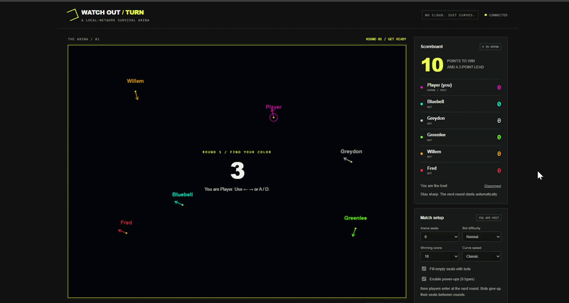

# Watch Out / Turn

## Update 1.2: six power-ups, rare drops, lighter processing

The game now contains **only the six requested power-ups**. All other effects have been removed from the item pool and effect handlers, not just hidden in the interface.



| Effect | Icon and color | Target | Duration |
| --- | --- | --- | --- |
| Increase speed for me | Green lightning bolt | Collector | 3 seconds |
| Increase speed for rivals | Red lightning bolt | Other living players | 3 seconds |
| Decrease speed for me | Green turtle | Collector | 10 seconds |
| Decrease speed for rivals | Red turtle | Other living players | 5 seconds |
| Reverse rivals' steering | Red recycling-style arrows | Other living players | 5 seconds |
| Traverse walls | Blue W | All living players | 10 seconds |

Drive over a token to activate it. There is no extra action key. Bots and humans use the same pickup and expiry rules. The host can disable all power-ups in the lobby. The in-game field guide shows only these six items, with cached, custom-drawn icons, pickup announcements and active effect timers.

### Rare drops

- The first drop attempt happens **12–18 seconds after a round goes live**.
- Every subsequent attempt is also spaced **12–18 seconds** apart, chosen randomly.
- There is **at most one uncollected token** on the arena at a time.
- An untouched token disappears after **12 seconds**.
- Tokens are placed in clear space, away from trails and nearby heads. If no suitable location is found, that attempt is skipped and the next rare interval still applies.
- Collecting a token does not trigger an immediate replacement or shorten the cooldown. No drop-rate-boosting effects remain.
- Short rounds can end without any power-up appearing. Drop timing advances during active simulation, not during the countdown or between-round screens.

The old 2.5–4.5-second attempt interval and six-token limit no longer apply.

### Movement and effect rules

- Speed boost is ×1.8 and slow is ×0.55. The wider turning radius under red Speed and tighter radius under green Slow are retained from the previous version.
- Recollecting the same effect refreshes its duration rather than multiplying its strength. Distinct speed/slow effects can coexist.
- Reverse swaps left/right on the server. Eliminated rivals do not receive effects, and disconnects still eliminate players.
- Traverse Walls wraps curves to the opposite side of the arena. It does **not** grant immunity to trails, heads or disconnects. Trails are never drawn across the map when a curve wraps.
- All curves have the normal trail thickness. There are no shrinking walls, teleport swaps, erasers, invulnerability, forced 90-degree turns or extra gap modifiers.
- Random starting positions and independent random headings remain. Starts are at least 115 pixels apart, away from walls, with a short checked opening runway; the countdown shows heading arrows.
- Bot difficulty parameters remain unchanged. The existing obstacle-avoidance policy accounts for the six active effects but does not chase items.

### Processing changes

- Collision scans skip empty/fresh-own cells before doing geometric work and use squared-distance comparisons instead of repeated square roots.
- Bot look-ahead reuses movement factors within each decision rather than recalculating them at every sample.
- The six token graphics are drawn once and cached, instead of reconstructing their shapes every display frame.
- Head interpolation reuses a lookup map, and ordinary playing frames no longer rewrite the overlay/control DOM. Timer screens still update.
- Ordinary network updates send only new trail segments. Reconnecting players and spectators still receive a complete snapshot; removed eraser effects no longer trigger full trail rebuilds mid-round.
- The simulation remains 60 Hz and state broadcasts remain 20 Hz; neither was reduced to hide the lag.

A local CPU comparison of 12 seeded eight-bot hard rounds, with power-ups disabled and state serialization at 20 Hz, produced identical round outcomes with lower processing cost. This is not a browser FPS measurement or a test of your computer/network, and it does not prove that frequent pickups caused the reported lag. A fresh multi-device play check is still needed.

Power-up names and retained durations were originally researched against the [archived Curve Fever 2 FAQ](https://web.archive.org/web/20180701000000/http://forum.curvefever.com/content/faq-powerup-effects). Drop timing and numerical movement multipliers are our own tuning, not a claim of exact historical reproduction. Icons and game code are custom; no historical game assets are copied.

A self-hosted, local-network curve-survival game. One computer runs the Node.js server; everyone else plays in their browser. Bots fill empty seats and run on the server, just like the rest of the game simulation.

## Start here

1. Download and extract the complete project ZIP. Keep all the files together in its `watch-out-turn` directory.
2. Install **Node.js 22 or newer** on the hosting computer. The other computers do not need Node.js.
3. Open a terminal in the extracted project directory and run:

   ```bash
   npm start
   ```

   Alternatively, run `node server.js`. On Windows, you can double-click `start-game.bat`; on macOS/Linux, run `bash start-game.sh`.

4. On the hosting computer, open **http://localhost:3000** in a browser.
5. The terminal prints one or more LAN addresses, such as `http://192.168.1.50:3000`. Share the address for your Wi-Fi/Ethernet adapter with everyone else on that same network.
6. Enter a name and join. The first human player becomes the host. Choose the settings, have everyone click **I'm ready**, then click **Start match**.

**There is no `npm install` step:** the server uses Node.js built-in modules and includes its own small WebSocket transport. No CDN, external font, cloud service, account, or database is needed to play.

**Do not just double-click `index.html`.** It is the browser client, not the server. It must be opened through the running server's HTTP address.

## Playing

- Your curve moves automatically. Hold **left/right arrow keys** or **A/D** to turn. Release to go straight.
- On touch devices, hold the on-screen left/right buttons.
- Avoid the boundary, every other trail, and your own trail.
- Trails periodically leave short gaps. You can cross where no trail was drawn. Gaps do not make you invulnerable.
- Your head is a yellow dot. A ring around the dot identifies your own curve; names are shown before the round starts.
- Every surviving player earns one point for each opponent eliminated in that simulation step. Simultaneous casualties do not earn points for outliving each other.
- The last curve standing wins the round. A round can end in a draw; a 90-second limit also ends unusually long rounds.
- Win the match by reaching the configured target **and** leading the runner-up by at least two points. The winner is checked at the end of a round.

## Lobby and bots

- The host can configure **2–8 desired seats**, bot filling, **easy/normal/hard** bot difficulty, **10/25/50** winning points, and relaxed/classic/fast speed.
- With bot filling on, empty seats are filled with bots. You can play alone against them.
- With bot filling off, at least two connected, ready humans are needed.
- The desired seat count is the bot-fill target, not a restriction on human participation: additional humans can join, up to eight human seats.
- People joining an active match wait until the next round. A bot then yields a seat. No one unexpectedly takes over a live curve.
- Bot scores carry across rounds while their seats remain in the match. A replaced bot leaves the standings.
- Spectators can watch without occupying a player seat. Disconnect and rejoin as a player if you want to participate.
- Disconnecting during a round eliminates your curve. A quick, automatic reconnect can restore your identity and score while the server retains your seat; it does not revive the eliminated curve. Disconnected seats may be removed between rounds or after the short grace period.
- If the host disconnects, another connected human becomes host.
- Between rounds, the host can return everyone to the lobby. Matches otherwise advance automatically. After a match ends, the host opens the lobby for a new match.

## Connecting on a LAN

- Share the host's **LAN IP address**, not `localhost`. On a different computer, `localhost` points to that computer, not the host.
- Keep the terminal and hosting computer running. Prevent sleep while you are hosting.
- If Windows asks whether to allow Node.js through the firewall, allow the **private/trusted network** only, subject to your organization's policy.
- If several addresses are printed, use the Wi-Fi/Ethernet address reachable by the players, not a Docker, VPN, or virtual adapter address.
- Guest Wi-Fi and access-point isolation can prevent devices from reaching each other. Company networks may do this too. Ask IT rather than bypassing network restrictions.
- Clipboard copying may be unavailable over plain LAN HTTP. The address is always displayed so you can copy it manually.
- You can check `http://HOST-IP:3000/health` to see whether the server is reachable.

### Change the port

If port 3000 is already in use:

**Windows PowerShell**

```powershell
$env:PORT=3001
npm start
```

**macOS/Linux**

```bash
PORT=3001 npm start
```

The server binds to `0.0.0.0` so it can accept LAN connections. Set `HOST=127.0.0.1` if you want to restrict it to the hosting computer for testing.

## Project files

| File | Purpose |
| --- | --- |
| `index.html` | Self-contained browser interface, Canvas rendering, input and WebSocket client |
| `server.js` | HTTP server, lobby, host permissions, connection management and match orchestration |
| `game.js` | Fixed-step simulation, trail collisions, scoring, and server-side bot steering |
| `websocket.js` | Dependency-free WebSocket server transport: masking, fragmentation, ping/pong, UTF-8 checks and payload limits |
| `package.json` | Startup and test commands; no external dependencies |
| `game.test.js` | Simulation, collision, scoring and deterministic bot tests |
| `powerups.test.js` | Random spawn/runway checks and power-up behavior, timing, physics and synchronization tests |
| `server.test.js` | Real TCP/WebSocket integration tests for lobby, permissions, spectators, reconnects and host handover |
| `client.test.js` | Client-logic smoke tests with a lightweight DOM stub |
| `start-game.bat` / `start-game.sh` | Convenience startup scripts |

### Architecture

The server runs a **60 Hz fixed-step simulation** and sends updates at **20 Hz**. Clients send only steering inputs, ready state and permitted lobby actions. Positions, collisions, random gaps, bots and scores are decided on the server. The browser maintains a trail layer and smooths head positions between received states. A spectator or reconnecting player receives the current round's trail history.

Bots inspect the authoritative occupancy grid and choose between left, straight and right using short look-ahead paths. Difficulty changes their decision interval, look-ahead distance and mistake rate. They are heuristic opponents, not an external AI service.

## Tests

Run:

```bash
npm test
```

The included **37 automated tests passed during development**, including 500 seeded eight-player spawn/runway checks, the exact six-item whitelist, effect targeting and expiry, rare-drop intervals and the one-token cap, cached-icon/client DOM checks, wall traversal, narrow-trail collision checks, real local TCP/WebSocket connections and bot simulations at all difficulties. The client tests use a DOM stub: they verify message handling and control logic, not actual browser rendering. A multi-device session on your own LAN and a visual browser check are still recommended; your network and firewall cannot be tested from here.

## Scope and safety

This is an initial complete **trusted-LAN prototype**, not an internet-facing service.

- One room per server process; up to eight human player seats, with bots filling unused slots. A maximum of 32 total WebSocket connections includes spectators and pending joins.
- Scores and rooms are stored in memory. Restarting the server resets them.
- No accounts, passwords, persistent leaderboard, room codes, TLS, or client prediction are included.
- Browser connections must match the server's origin. The server validates inputs, checks host permissions, bounds message sizes, applies a message-rate limit, and avoids exposing its source files over HTTP.
- These checks are **not authentication**. Anyone who can reach the LAN server can join, and the first human to join becomes host. Traffic uses unencrypted HTTP/WebSocket.
- **Do not expose this server through router port forwarding or a public tunnel.** Internet deployment would need a separate security and networking design. The bundled lightweight WebSocket transport is intended for this limited LAN prototype, not as a general-purpose, independently audited replacement for a maintained production library.
- No computer's firewall or network configuration is modified automatically.
